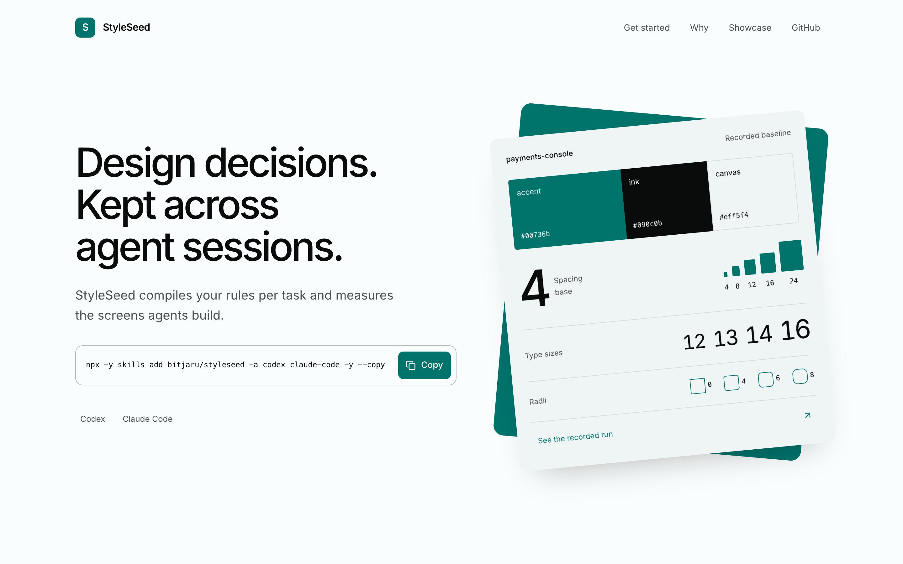
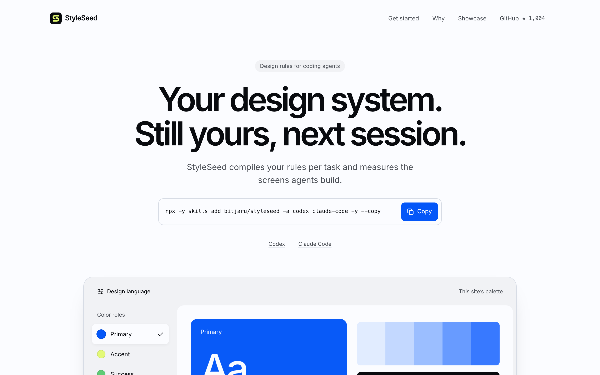
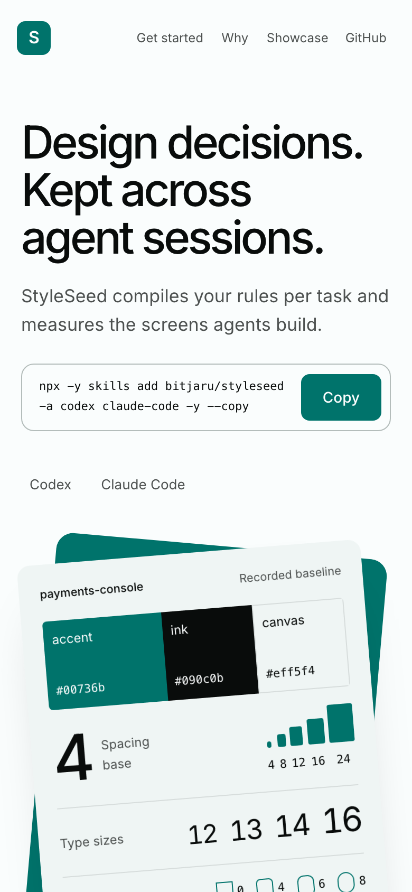
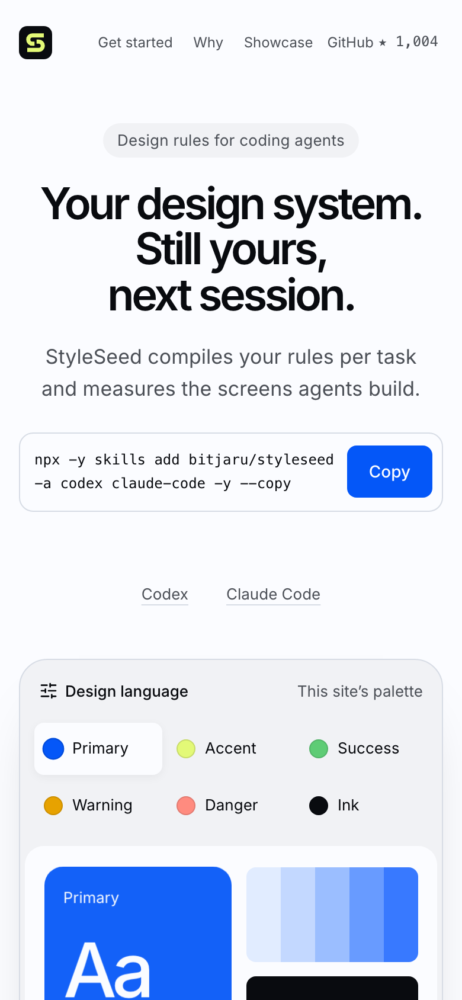
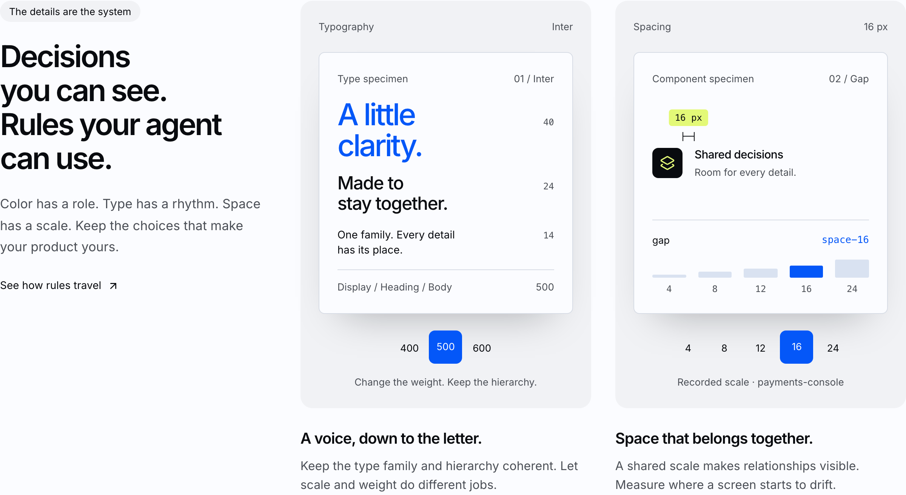

# Landing render evidence — 2026-11-10

Route: `/`. Artifact: `site-home`.

The maintainer approved the current rendered landing and authorized merging it on
2026-11-10. This approval covers the landing design; it is not a general quality
claim about the engine or other routes.

The page uses the expressive-marketing / product-ui / developer-tools / landing /
expressive-brand contract, Inter, and a landing-scoped generated blue/citrus palette.
Neutral stages contain interactive type and spacing specimens, the recorded report
uses labeled gap diagrams, and copy completion uses a compact citrus check.

## Before and after

Before: the live pass-4 page captured on 2026-11-10, while main was `80f5f59`.
After: the approved local production build at 1440×900 and 390×844, at 2× density.

| Before | After |
| --- | --- |
|  |  |
|  |  |

## Validation

- `npm run build` in `demo-pricing`: passed.
- `node scripts/verify-repo.mjs --browser`: passed on the final submitted tree
  before opening the PR (`Repository verification passed (full + browser).`).
- The task-local Playwright harness exercised 15 scenarios on the final production
  build. [Recorded results](browser-verification.json) include actual clipboard
  copy and denial recovery, no layout overlap in the mobile error state, keyboard
  and touch selection, all nine rules through native disclosure, exact 4× gap
  diagrams, reduced motion, no-JS content, and applied contrast.
- Historical comparison image, measured values, install commands, engine source,
  release version, and shared secondary-route palette remain unchanged.

The deterministic scan still reports the pre-existing stale site-home manifest
(SS000, tracked separately in #114) and 61 raw-pixel warnings (SS002). No clean
StyleSeed code score is claimed; the landing handoff explicitly leaves #114 to
its separate workstream.
